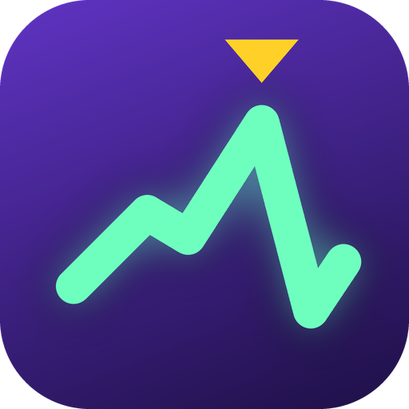

# Screen Stocks Bot

A trading bot for the game **Screen Stocks** (Windows). It reads the game's official mod export, places trades through the game's mod command files and shows everything on a live dashboard at http://127.0.0.1:8641.

*Fan-made. Not affiliated with the developers of Screen Stocks.*

## Install

1. In Screen Stocks, open **Settings** and turn on **Mod Support**. Keep the game running.
2. [Download this repo as a ZIP](../../archive/refs/heads/main.zip) and unzip it anywhere, for example `Documents\Screen Stocks Bot`.
3. Double-click **Install.bat**. It checks for Python 3.10+ (and offers to install it), adds Desktop and Start menu shortcuts, and starts the bot.
4. On the dashboard, press **Arm**. Until then the bot only watches.

To stop it use the **Stop Screen Stocks Bot** shortcut. To remove it run **Uninstall.bat**, then delete the folder.

## What it does

| | |
|---|---|
| **$WHALE cap shorts** | Shorts $WHALE near its 1000 cap and covers on the crash that usually follows. The biggest earner. |
| **Crash buys** | Buys $WHALE crashes of 45% or more and sells the rebound. |
| **Dividend parks** | Keeps idle cash in the best-paying stocks, buying in the cheapest part of the last hour. |
| **$TECH harvest** | Sells $TECH spikes and buys back after the crash. |
| **Swing trades** | A strategy per stock, backtested on recorded prices and refitted as the market changes. |
| **News events** | Trades announced pumps and crashes. |
| **Upgrades** | Picks the upgrade that pays back fastest. |
| **Auto go-public** | Optional (off by default): goes public when allowed, using real mouse clicks only while you are away from the PC. Turn on `autoIpo` on the dashboard. |
| **Safety** | Circuit breaker, per-trade size caps, and a watchdog that restarts the bot if it crashes. |

## Notes

- Settings live in `data\config.json` and can be changed on the dashboard. `recommended-config.json` holds the starting values.
- Price history, trades and logs are stored in `data\`.
- Trades go through the game's normal mod support, so the game's own cooldowns and limits apply.
